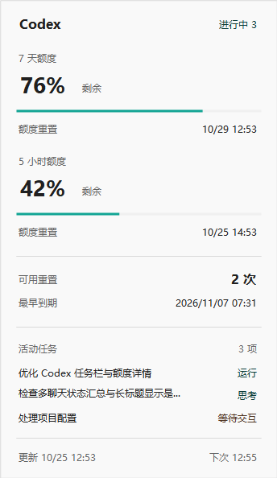
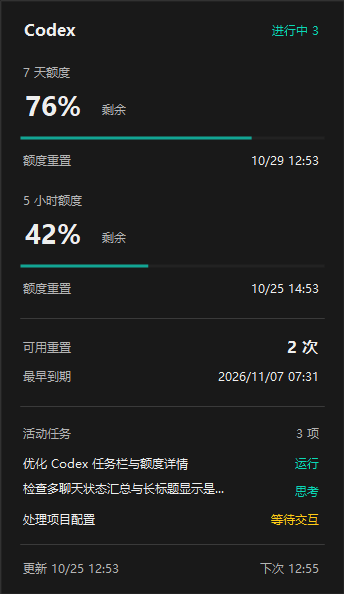

# Codex Quota for TrafficMonitor

在 Windows 任务栏显示 ChatGPT 订阅中的 Codex 剩余额度、重置倒计时和任务状态。悬停只显示 Codex 信息：额度周期、重置时间、可用重置次数、权益到期时间，以及正在工作的聊天。


本项目是独立的 TrafficMonitor 插件，不是 OpenAI 官方产品。

## 下载与安装

从 [Releases](https://github.com/fengziclassmate/codex-quota-trafficmonitor/releases/latest) 下载：

- `CodexQuota-TrafficMonitor-x64.zip`：包含 TrafficMonitor 1.86 x64 Lite、插件和源码。解压后运行 `TrafficMonitor.exe`，自动开始额度查询和状态监听。
- `CodexQuota-plugin-x64.zip`：关闭已有的 x64 TrafficMonitor，将 `plugins` 中三个文件复制到宿主的 `plugins` 目录，再启动宿主，在任务栏“显示设置”中勾选 Codex 项目。

从旧版升级时先退出 TrafficMonitor，再替换 **DLL 和 EXE 两个文件**。保留自己的 `config.ini` 和 `plugins/CodexQuota.ini`。

运行环境：Windows 10/11 x64、x64 TrafficMonitor、.NET Framework 4.6.2 或更新版本，以及已通过 ChatGPT 账户登录的 Codex CLI 或 Codex Desktop。本次实测环境为 Windows build 26300、TrafficMonitor 1.86、Codex CLI 0.163.0-alpha.11.2；其他系统版本的任务栏兼容性由 TrafficMonitor 决定。

便携包默认只显示剩余额度、任务状态、重置倒计时。插件右键菜单可手动刷新额度；已有宿主的用户可取消其他任务栏项目。

## 界面与操作

v0.2.0 使用紧凑的任务栏排版和独立详情浮层，替换原来的长文本提示和消息框。

- 悬停查看额度、重置次数、到期时间和活动任务，不抢走键盘焦点。
- 单击固定详情，按 Esc、“关闭”或点击其他窗口收起。
- 自动适配 Windows 应用的浅色、深色主题和显示缩放；不添加过渡动画。
- 额度按周期分别显示百分比与进度条；有多项重置权益时显示最早到期时间。

界面预览（演示数据）：




自绘文本和浮层使用 [Radix Colors](https://www.radix-ui.com/colors/docs/palette-composition/understanding-the-scale)，背景、分隔线和文字按其色阶用途分配。详情使用 12、16、28 px 三种字号，边框与分隔线为 0.5 px。任务栏文字使用宿主设置的字体；便携包默认 9 pt。

## 额度配置

插件通过本机 `codex app-server` 的 `account/rateLimits/read` 查询额度，默认间隔 120 秒。查询不创建模型任务。

它首先寻找 Codex Desktop 的本地 CLI，然后检查 PATH。如果未找到，在 `plugins/CodexQuota.ini` 中填写实际路径：

```ini
[plugin]
codex_path=C:\path\to\codex.exe
```

周期长度使用账户返回值，不固定为“5 小时额度 + 每周额度”。返回两个周期时依次显示两个剩余比例。倒计时到零后显示“待同步”，等待服务器确认，不自行将额度恢复为 100%。

重置权益按服务器的 `availableCount` 显示可用次数；返回明细时显示到期时间。接口未提供明细或时间时显示“未知”。插件只展示权益，不兑换或消耗重置次数。时间按本机时区显示。

## 自动监听所有聊天

自 v0.1.1 起，状态监听随 TrafficMonitor 自动启动。**已有聊天和新聊天都自动纳入，不需要逐个指定 JSONL 文件或重新打开聊天。** 监听器随宿主退出。

v0.1.2 修复 Codex 保存 `\\?\C:\...` 扩展路径后，.NET 旧路径处理导致监听器退出、任务栏显示“状态不可用”的问题。监听器启用支持扩展路径和长路径的 .NET 文件处理。

监听范围为当前用户同一 `CODEX_HOME` 下、正在被 Codex 加载的主聊天；默认目录为 `%USERPROFILE%\.codex`。若使用自定义目录，请在启动 TrafficMonitor 前设置相同的 `CODEX_HOME` 环境变量。远程机器或其他用户目录的任务不在此范围。

| 状态 | 含义 |
| --- | --- |
| 思考中 N | 有 N 个进行中的主聊天，当前未观测到其工具调用在运行。此状态是处理阶段的概括。 |
| 运行中 N | 观测到工具开始且尚未返回；同时思考的聊天也计入活动数量。 |
| 等待交互 N | 只有等待输入或批准的聊天，没有仍在执行的聊天。同步输入请求等待返回；异步提问发送完毕后继续计为工作。 |
| 批准/执行 N | 已收到批准请求，工具尚未返回；当前事件不能独立区分批准后开始执行的时刻，因此合并显示。 |
| 进行中 N | 同时有正在工作和等待交互的聊天。 |
| 已完成 / 已中断 / 任务失败 | 所有聊天均无活动任务时，显示最近约 60 秒内的结束状态。 |
| 空闲 | 监测有效，已加载的主聊天中没有活动任务。 |
| 读取中 / 状态不可用 | 监听正在启动或数据不可用，不将未知情况显示为空闲。 |

悬停提供各状态数量和最多三个活动聊天的标题。一项任务完成不会覆盖其他仍在工作的聊天；已关闭的聊天和子代理独立聊天不计入活动数量。

监听通过只读数据库查询自动发现聊天，并增量读取当前轮次的本地 JSONL 事件。当前适配 `state_5.sqlite`、`thread_history_1.sqlite` 和已验证的会话事件格式；Codex 升级改变这些内部格式时可能需要适配。状态反映可观测到的生命周期事件，不能证明模型内部的具体计算活动。

## 可选：补充批准事件

自动监听不要求安装 Hooks。若希望补充本地工具的批准事件，可使用官方 Hooks：

1. 将 `Enable-Status.cmd`、`Disable-Status.cmd` 放在 `TrafficMonitor.exe` 同目录，插件保持在固定路径。
2. 运行 `Enable-Status.cmd`。安装器合并用户级 `hooks.json`，保留其他 Hooks，并在覆盖前生成备份。
3. 打开 Codex CLI，输入 `/hooks`，审阅并信任指向本插件 `CodexQuotaBridge.exe` 的 8 个监听项。
4. 重新打开需要加载新 Hooks 的聊天。自动监听在此之前也能工作。

安装器不会写入或伪造 Codex 信任记录。更改监听定义或移动插件路径后需要重新审阅。`Disable-Status.cmd` 只移除当前路径对应的 Hooks；自动监听仍随宿主运行。托管工具及部分专用路径不发出本地工具 Hooks，批准事件的覆盖受 Codex 限制。

旧版手动 `watch` 命令保留兼容；普通使用无需启动它。

## 数据与隐私

- 本地缓存位于 `%LOCALAPPDATA%\CodexQuota`；可用 `CODEX_QUOTA_DATA_DIR` 环境变量指定其他目录。
- 持久化额度、聊天标题、会话/轮次标识、工具名称、状态、时间和进程标识，用于任务栏展示与监听。
- 不保存提示词、工具参数、工具输出或推理正文。会话事件在内存中解析，只保留状态元数据。
- 插件不读取、上传或展示登录令牌，不建立遥测服务器。额度请求由已有 Codex 登录完成。
- `*` 表示查询失败或数据超过 5 分钟未更新，详情显示具体原因。

## 构建与验证

源码在 `src`。构建需要 Zig 0.15.2 和 Windows 自带的 .NET Framework C# 编译器：

```powershell
.\src\build.ps1 -ZigPath 'C:\path\to\zig.exe'
```

先退出 TrafficMonitor。脚本运行 35 项额度、重置权益、事件解析、界面数据和多聊天汇总检查，再生成 Microsoft C++ ABI 的 x64 DLL 和 x64 .NET 查询/监听程序，输出到 `plugins`。中间产物位于 `src/work/build`。

有 Windows Python 3 时，可进一步验证自动发现新聊天、一个聊天结束但另一个仍运行、排除子代理和移除已关闭聊天：

```powershell
python .\tests\monitor_integration.py
```

该测试只创建隔离的模拟数据库和测试进程，不修改真实 Codex 数据，并包含 Windows 扩展路径用例。v0.1.2 在旧程序上复现该用例失败，修复后通过；真实桌面同时识别两个活动主聊天，监听心跳正常，连续四秒悬停无隐藏或重新弹出。

界面渲染回归测试：

```powershell
.\tests\check-ui.ps1
```

使用隔离演示数据，检查浅色、深色和 100%、125%、150% 缩放下的字体有效性、控件边界、对齐、最小字号与文字对比度。渲染图保存在 `tests/work/ui`。v0.2.0 已通过实际悬停不抢焦点、持续五秒显示、点击固定、Esc 关闭和重复打开验证；开发中发现的共享字体提前释放问题也由此用例覆盖。

## 常见问题

- **额度显示 ERR**：确认 CLI 使用 ChatGPT 登录、网络可用，必要时设置 `codex_path`。API Key 余额不在展示范围。
- **工作中的聊天未被统计**：确认宿主与 Codex 使用相同用户和 `CODEX_HOME`，并确认已同时更新 DLL 与 EXE。内部数据库格式变化可能需要适配。
- **悬停没有内容**：确认 DLL 和 EXE 已同时更新，浮层进程会随宿主启动；若 `panel-error.log` 存在，可在本地缓存目录查看具体异常。
- **状态停在批准/执行**：该阶段在工具返回后清除；当前事件没有独立的批准后执行通知。
- **没有任务栏数字**：确认宿主和插件同为 x64、已勾选 Codex 项目，并检查 TrafficMonitor 与当前 Windows 版本的兼容性。
- **迁移目录**：退出宿主后移动整个文件夹；若安装过可选 Hooks，先从旧目录停用，再从新目录启用并重新信任。

## 来源与许可

TrafficMonitor 与 `PluginInterface.h` 原作者为 Zhong Yang，使用 [Anti 996 License](LICENSE)。本项目保留原版权声明和许可；便携包中的宿主为上游发布的原版。

- [TrafficMonitor](https://github.com/zhongyang219/TrafficMonitor)
- [TrafficMonitor 插件开发文档](https://github.com/zhongyang219/TrafficMonitor/wiki/Plugin-Development-Guide)
- [OpenAI：账户额度接口](https://learn.chatgpt.com/docs/app-server)
- [OpenAI：Hooks、事件覆盖和信任机制](https://learn.chatgpt.com/docs/hooks)
